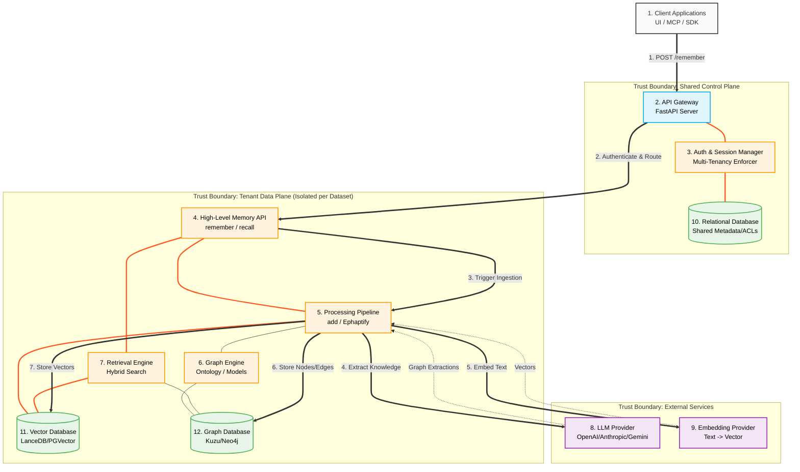

# EphapticOS Architecture

The following diagram illustrates the high-level architecture of EphapticOS, highlighting the core runtime components, trust boundaries, external dependencies, and the primary data ingestion path (`remember`).

## Component Detail Cards

Instead of tangling the diagram with dense technical details, refer to the cards below for the responsibilities of each numbered component.

> [!NOTE] 
> **1. Client Applications**
> Connects to the system via HTTP or SSE. Includes the `EphapticOS-frontend` (Next.js), `EphapticOS-mcp` (Model Context Protocol server for IDEs), and the `EphapticOS-cli`.

> [!NOTE] 
> **2. API Gateway**
> The `FastAPI` layer (`EphapticOS.api.client`) serving REST endpoints. Handles basic HTTP routing, error formatting (`CogneeApiError`), and global lifecycle events.

> [!NOTE] 
> **3. Auth & Session Manager**
> Checks `ENABLE_BACKEND_ACCESS_CONTROL`. Validates API keys/JWTs, resolves tenant context, and manages active session cache logic (`CACHE_BACKEND`). Enforces multi-tenancy before data plane access.

> [!NOTE] 
> **4. High-Level Memory API**
> Provides the public `remember`, `recall`, `improve`, and `forget` entry points. Abstracts the underlying graph structure from the end user.

> [!NOTE] 
> **5. Processing Pipeline**
> The low-level ingestion engine. Orchestrates the `add` (chunking) and `Ephaptify` (LLM graph extraction) stages. Manages background concurrency using `DATASET_QUEUE_ENABLED`.

> [!NOTE] 
> **6. Graph Engine**
> Validates data against `graph_models` (e.g. `DataPoint`), deduplicates entities (identity matching), and maintains the system's ontology. 

> [!NOTE] 
> **7. Retrieval Engine**
> Orchestrates `search` and `recall`. Combines vector similarity searches with graph traversals (e.g., retrieving neighbor nodes and edge properties) to generate contextual context.

> [!NOTE] 
> **8. LLM Provider**
> External API used for unstructured data extraction (e.g., entity/relationship extraction during `Ephaptify`) and synthetic reasoning (e.g., `AUTO_FEEDBACK` evaluation).

> [!NOTE] 
> **9. Embedding Provider**
> Generates dense vector representations for document chunks and extracted entities to enable semantic search capabilities.

> [!NOTE] 
> **10. Relational Database (Shared)**
> A single shared database (SQLite, Postgres, or Turso) that stores cross-tenant data such as users, permissions, dataset registries, and API keys.

> [!NOTE] 
> **11. Vector Database (Isolated)**
> Tenant-isolated database (LanceDB, PGVector). A unique instance/schema is maintained per dataset to guarantee data isolation and boundary compliance.

> [!NOTE] 
> **12. Graph Database (Isolated)**
> Tenant-isolated database (Ladybug/Kuzu, Neo4j, Postgres). Operates concurrently with the vector store, handling structural knowledge schemas independently per dataset.
